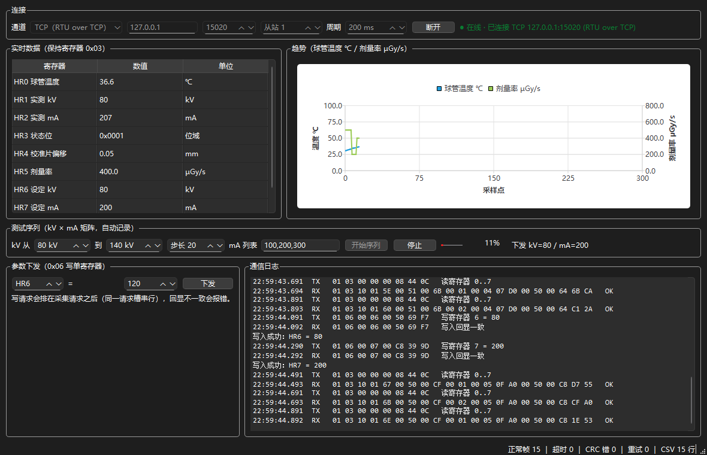

# qt-hmi-modbus · CT 样机测试上位机（C++/Qt）

[](https://github.com/vacalono/qt-hmi-modbus/actions/workflows/ci.yml)

面向**医疗设备（CT）新机图像质量测试**的上位机：两条工作流各占一个页签 —— **在线采集**（kV / mA 矩阵下发 → 周期读回球管温度、剂量率、校准片偏移 → 显示/曲线/落盘）与**离线核对**（导入导出的测试数据 → 按均匀性/噪声判定 → 标红不合格 → 导出核对报告）。
配套一个可注入故障的**模拟下位机**（Modbus RTU over TCP），没有硬件也能完整跑通采集、异常与恢复。



> **边界先说清**：这是一个**独立项目**，不是任何公司软件的代码或替代品。它复现的是「设备参数下发 → 等读数稳定 → 记录一组数据」这类测试台场景；数据全部来自本项目自带的模拟下位机。

## 为什么做这个

实习里做的是"新设备图像质量测试 + 数据核对"：5 台设备、多档管电压/电流组合、127 组数据，取数靠人工导、一次 4 小时。
这个项目把那条链路的软件侧补完整：**参数下发（可成组扫矩阵）→ 定时采集 → 实时显示 → 落盘记录 → 异常可恢复**，并显式做出丢帧、坏 CRC、断线三条异常路径。

## 功能

| 模块 | 内容 |
|---|---|
| 协议 | Modbus RTU：CRC-16/MODBUS、0x03 读保持寄存器、0x06 写单寄存器、0x10 写多寄存器、异常响应（功能码 \| 0x80）解析 |
| 传输 | `ITransport` 抽象 + `TcpTransport`（RTU over TCP，本地联调）/ `SerialTransport`（QSerialPort 8N1，现场）；上层不感知通道差异 |
| 采集 | 周期可配（默认 300 ms）、从站地址、寄存器段；**同一时刻只允许一个在途请求**，一问一答避免应答错配 |
| 异常 | 250 ms 应答超时；连续 3 次失败判掉线 → 0.5/1/2/4/8 s 退避重连；半包等待、粘包切帧、CRC 错单独计数 |
| 显示 | 8 个寄存器表（工程单位换算）+ QtCharts 双 Y 轴曲线（球管温度 / 剂量率），300 点滚动 |
| 参数下发 | 写设定 kV / mA，校验回显一致才算成功；写请求排到采集请求之后串行执行 |
| **测试序列** | 按 **kV × mA 矩阵**自动跑：逐组下发 → 等 900 ms 稳定 → 采样记录 → 下一组；带进度条，可中途停止 |
| 记录 | 连续采集 `csv_*.csv`（时间戳/温度/kV/mA/状态/校准偏移/剂量率/设定值）；测试序列 `scan_*.csv`（逐组一行） |
| **离线核对** | 导入导出的测试数据 CSV（device,batch,kv,ma,ct_center,ct_edge,noise）→ 算 CT 值均匀性（\|中心−边缘\|）与噪声 → 按阈值判定合格/不合格（超限行标红）→ 汇总通过率与不合格集中设备 → 导出 Markdown 核对报告 |
| 日志 | TX/RX 帧 Hex 双向日志 + 状态机事件 + 错误原因 |
| 测试 | QtTest 9 例：CRC 标准校验值、帧布局、正常/异常响应、坏 CRC、写回显不一致 |

## 寄存器映射

| 地址 | 含义 | 单位 / 编码 | 权限 |
|---|---|---|---|
| HR0 | 球管温度 | ×10 ℃ | 只读 |
| HR1 | 实测 kV | kV | 只读 |
| HR2 | 实测 mA | mA | 只读 |
| HR3 | 状态位 | 0x0001 就绪 / 0x0002 曝光中 / 0x0004 校准中 | 只读 |
| HR4 | 校准片偏移 | ×100 mm | 只读 |
| HR5 | 剂量率 | ×10 µGy/s | 只读 |
| HR6 | 设定 kV | kV | 读写 |
| HR7 | 设定 mA | mA | 读写 |

## 架构

```
┌──────────────────────────── ui ─────────────────────────────┐
│ MainWindow（寄存器表 / 曲线 / 测试序列 / 参数下发 / 日志）     │
└──────────▲────────────────────┬──────────────────▲────────────┘
   sample/stateChanged     enqueueWrite      progress/finished
┌──────────┴────────────────────▼──────────────────┴────────────┐
│ PollEngine：轮询节拍·在途请求槽·超时·重试·退避重连             │
│ ScanController：kV×mA 矩阵 → 下发 → 等稳定 → 记录              │
├───────────────────────────────────────────────────────────────┤
│ ModbusFrame：CRC16 / 帧构造 / 响应解析（含异常码）             │
├────────────────────────── UI 线程 ─────────────────────────────┤
│ TransportChannel：通道门面（open/write 投递到 I/O 线程）      │
╞══════════════════════════ 队列边界 ═══════════════════════════╡
│ IoWorker（独立 QThread）：持有设备、收字节、发信号回 UI 线程   │
├───────────────────────────────────────────────────────────────┤
│ ITransport：TcpTransport（RTU over TCP） / SerialTransport    │
└───────────────────────────────────────────────────────────────┘
```

分层的意义：协议层可被单元测试直接覆盖；换通道不动上层；UI 只订阅数据与状态；测试序列复用采集引擎的写入队列，不另开一套通信。

**为什么 I/O 单独一条线程**：串口/DLL 阻塞或界面重绘会互相拖死。设备读写在 `IoWorker`（独立线程）里做，UI 线程只处理「收到的字节」和重绘——实测界面每 100 ms 忙等 95 ms，采集帧数仍是 8 s/79 帧、0 超时（见下表）。

## 构建

依赖：Qt 6.8（Widgets / Charts / Network / SerialPort / Test）+ MinGW 13.1 + qmake。

```bash
# 上位机
mkdir -p out/app && cd out/app
qmake ../../hmi_app.pro CONFIG+=release && mingw32-make -j8    # → release/hmi_app.exe

# 模拟下位机
mkdir -p out/sim && cd out/sim
qmake ../../sim/device_sim.pro CONFIG+=release && mingw32-make -j8

# 单元测试
mkdir -p out/tests && cd out/tests
qmake ../../tests/tests.pro CONFIG+=release && mingw32-make -j8 && ./release/tst_modbus.exe
```

## 运行

```bash
cd dist
./device_sim.exe      # 先起模拟样机：127.0.0.1:15020
./hmi_app.exe         # 打开上位机，点「连接」，需要时点「开始序列」
```

`dist/` 已用 `windeployqt` 打包 Qt DLL，双击即可运行，不需要装 Qt。

**无头冒烟 / 测试序列**

```bash
./dist/hmi_app.exe --smoke --seconds 8 --interval 100
./dist/hmi_app.exe --smoke --seconds 20 --interval 100 --scan     # 顺带跑 3×3 矩阵
```

**离线核对（不需要设备）**

```bash
python tools/gen_sample_data.py     # 生成 127 组样例导出数据（含 7 组注入缺陷）
./dist/hmi_app.exe --check testdata/export_5devices_127.csv --report docs/qc_report.md
# → check_result total=127 passed=120 failed=7
```

界面上对应「离线核对」页：选 CSV → 调阈值 → 超限行标红 → 「导出核对报告」。
样例界面：`docs/screenshot_offline.png`

**故障注入**

```bash
SIM_FAULT=drop    ./dist/device_sim.exe   # 每 5 帧丢 1 帧 → 超时与重试
SIM_FAULT=corrupt ./dist/device_sim.exe   # 每 5 帧破坏 CRC → CRC 校验失败
SIM_FAULT=slow    ./dist/device_sim.exe   # 每帧延迟 400 ms → 应答超时
```

## 实测数据（本机 i5-12490F）

| 场景 | 结果 |
|---|---|
| 正常 8 s / 100 ms | 正常帧 **73**、超时 0、CRC 错 0、CSV 73 行 |
| 丢 10 帧（`drop`） | 超时 **10**、重试 10、正常帧 43，**采集不中断，自动恢复** |
| 坏 14 帧（`corrupt`） | CRC 错 **14**、正常帧 60、CSV 60 行 |
| 测试序列 3×3（`--scan`） | **9 组全部记录**：kV 80/100/120 × mA 100/200/300，球管温度随功率 36.7 → 54.0 ℃，剂量率 200 → 900 µGy/s |
| 离线核对 127 组（`--check`） | 总数 **127** ｜ 合格 **120** ｜ 不合格 **7** ｜ 通过率 **94.5%**；均匀性最大 14.20 HU、噪声最大 5.10 HU；不合格集中在 CT-05（4 组）与 CT-03（3 组），与样例数据里注入的 7 处缺陷**完全对得上** |
| UI 线程 95 ms 忙等（`--ui-load 95`） | 8 s 仍是 **79 帧、0 超时、0 CRC 错**——I/O 在独立线程，界面卡顿不吃数据 |
| UI 线程饱和 200 ms 忙等（`--ui-load 200`） | 6 s **31 帧**（节拍被 UI 定时器拖慢，属预期），**仍 0 超时、0 CRC 错** |
| 单元测试 | **11 passed / 0 failed**（Qt 6.8.3 / GCC 13.1.0）；其中 2 个是跨线程回归：I/O 线程必须不同于 UI 线程、字节双向跨线程不丢 |

## 持续集成（GitHub Actions · Ubuntu 24.04 / Qt 6.4.2）

`.github/workflows/ci.yml` 每次 push 全跑一遍，绿了才算改完：

| 步骤 | 断言 |
|---|---|
| 构建 | 上位机 / 模拟样机 / 单元测试三个 qmake 工程都能编过（Linux + Qt 6.4.2，与 Windows 的 6.8.3 双环境） |
| 单元测试 | `tst_modbus` 全通过，且含两个跨线程用例（I/O 线程 ≠ UI 线程、字节双向跨线程） |
| 在线冒烟 | 8 s / 100 ms：帧数 ≥ 50、超时 0、CRC 错 0 |
| 界面压力回归 | `--ui-load 95`：帧数仍 ≥ 50，且 `io_thread ≠ ui_thread` |
| 离线核对 | 127 组 → `failed=7`（判定逻辑不能被改坏） |
| 产物 | 核对报告上传为 artifact |

Linux 上的实测（run 40637585996）：单元测试 **11 passed / 0 failed**；冒烟 **81 帧 / 8 s**、0 超时；UI 忙等 95 ms 时 **78 帧**；离线核对 **127 → 120 / 7**。

## 设计决策（面试会被问到的）

1. **为什么用 RTU over TCP 演示**：本机没有 com0com 虚拟串口对，串口通道无法自测；Modbus RTU 帧与传输无关，塞进 TCP 就能验证解析/超时/重连。现场把 `ITransport` 换成 `SerialTransport` 即可，上层零改动。（串口实现已写好，但未接真实设备验证。）
2. **为什么必须有"在途请求槽"**：第一版没有它，100 ms 周期 + 250 ms 超时时会连发多帧，超时永远不触发、迟到的应答还会被当成下一次请求的结果。加 `m_inFlight` 后，`drop` 场景能稳定测出 10 次超时。
3. **为什么连续 3 次失败才重连**：偶发丢一帧就重连会把抖动放大；3 次≈几个采集周期，退避从 0.5 s 起翻倍，避免把对端打挂。
4. **为什么写操作要串行**：Modbus 一问一答，写与读同时只能有一个在途，否则写回显可能被读响应顶掉。
5. **参数矩阵为什么要等 900 ms 再采样**：kV/mA 改完，球管温度与剂量率是惯性变化的，立刻读会记到上一组的稳态值。900 ms 是模拟器一阶惯性参数下够用的值（真实设备按厂家手册的稳定时间设）。
6. **CSV 逐行 flush**：300 ms 一行，宁可多一次 IO 也不要在断电时丢最后一秒；高频场景才需要批量写。
7. **为什么把设备 I/O 搬到独立线程**：`QSerialPort`/`QTcpSocket` 在 UI 线程时，界面一卡（重绘、导出、系统卡顿）读写就被拖住。现在 `IoWorker` 在独立 QThread 持有设备，`TransportChannel` 只做门面：UI 线程 `write()` 投递过去，收到的字节经队列信号回来。实测 UI 忙等 95 ms/100 ms 时帧数不变。
8. **为什么不把整个采集也搬进线程**：轮询节拍在 UI 线程，解析/落盘也在这里——UI 完全饱和（200 ms/100 ms）时节拍会掉到约 5 Hz（6 s 31 帧）。这是有意的取舍：先把"界面卡顿导致数据丢"这个真问题解决，再决定要不要把 PollEngine 也线程化（要动锁和状态机，收益在 10 Hz 以上才明显）。

## 目录

```
src/protocol/ModbusFrame.*      协议：CRC、帧构造、响应解析
src/transport/ITransport.h      传输抽象
src/transport/TcpTransport.*    RTU over TCP
src/transport/SerialTransport.* QSerialPort
src/transport/IoWorker.*        I/O 线程：持有设备、收发字节
src/transport/TransportChannel.* UI 侧门面：投递调用、回传信号
src/core/PollEngine.*           轮询、超时、重试、退避重连
src/core/ScanController.*       kV×mA 测试序列
src/core/QcChecker.*            离线核对：均匀性/噪声判定 + 报告
src/core/CsvLogger.*            连续采集落盘
src/ui/MainWindow.*             界面与交互（在线采集 / 离线核对两页）
sim/device_sim.cpp              模拟样机（含故障注入）
tests/test_modbus.cpp           QtTest 用例
tools/gen_sample_data.py        生成 127 组样例导出数据（含注入缺陷）
.github/workflows/ci.yml        持续集成：构建 + 单测 + 冒烟 + 压力回归 + 离线核对
testdata/export_5devices_127.csv 样例数据
docs/qc_report.md               离线核对报告样例
dist/                           已打包（含 Qt DLL）可直接运行
```

## 已知边界（不吹的部分）

- 只实现 0x03 / 0x06 / 0x10；单从站；无多设备轮询表；
- 串口通道未在真实设备验证（无硬件）；
- 离线核对只支持 CSV（不解析 Excel/xlsx）；判定阈值手工设，没有从标准文件读阈值；
- 没有历史回放、报警阈值、用户权限（真实工控软件必备，本项目未做）；
- 未接工业相机 SDK、运动控制卡、PLC；
- Linux 上只做到「编译 + 无头跑通（offscreen）」，没有打 Linux 安装包、也没做桌面环境下的截图验证；
- 只有**传输层**在 I/O 线程，轮询节拍/解析/落盘仍在 UI 线程；UI 完全饱和时节拍会下降（见实测表）；
- 模拟器物理量是简化模型（温度一阶惯性、剂量率与功率近似成正比），不是真实设备的标定曲线；`testdata/` 里的 127 组是**合成数据**，不是真实测量值。

## 代码规模

约 **3137 行**（C++ / 头文件 / Python / qmake 工程）：`src/` 约 2680 行（UI 918、传输层约 590），模拟器 274 行，测试 157 行，数据生成 90 行。